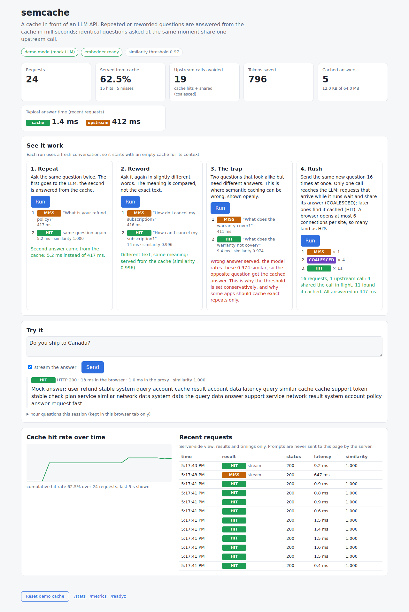
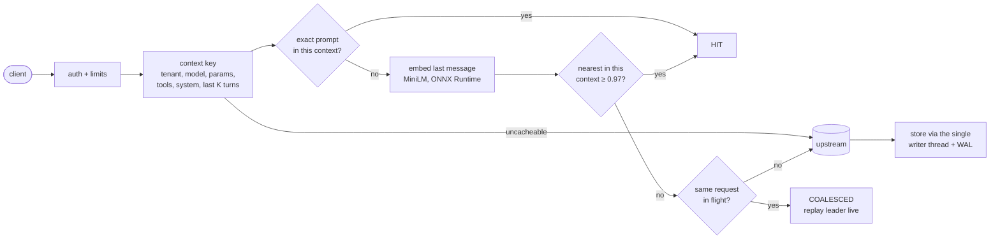

# semcache

A semantic caching proxy for LLM APIs, in C++20. Point an OpenAI-compatible client at it
(`base_url`), and it answers repeated or reworded questions from a cache, merges identical
requests that are in flight at the same time into one upstream call, and passes everything else
through untouched.



*The built-in dashboard in demo mode (screenshot taken by the browser test, `tools/dashboard_e2e.py`).*

## What it does

- **Drop-in:** `POST /v1/chat/completions`, JSON and streaming (SSE). Every response carries
  `X-Semcache: HIT | MISS | COALESCED | BYPASS` and, when a comparison was made, the similarity.
- **Only safe reuse:** a cached answer is considered only if *everything except the last user
  message* matches exactly: tenant, model, every generation parameter, tools, system prompt and
  the last K turns, hashed into a context key. Within that context, the last message is compared
  by meaning (all-MiniLM-L6-v2 embeddings, cosine ≥ 0.97), and repeats that differ only in case,
  spacing or final punctuation skip the model.
- **Coalescing:** N identical requests in flight → one upstream call; the others get the same
  answer, streamed live.
- **Fails open:** if any part of the cache layer fails (embedder, index, queue full, disk), the
  request is forwarded upstream. The cache never fails a request upstream would have served.
- **Multi-tenant by construction:** the tenant id is part of the context key, so one tenant can
  never read another's entries. Proxy-issued keys; only their SHA-256 is kept.
- **Durable:** snapshot + write-ahead log with CRC32C, torn-tail recovery, model fingerprint;
  tag-based purge (`POST /admin/purge`).
- **Observable:** JSON logs with prompts redacted, Prometheus `/metrics`, `/healthz`, `/readyz`,
  `/stats`, `/stats/stream`, and a dashboard at `/dashboard` compiled into the binary.
- **Bounded:** body sizes, in-flight requests, queues, per-tenant and per-address rate limits,
  memory budgets with TTL + CLOCK eviction, timeouts on every I/O.

## Quick start (demo, nothing paid)

```bash
docker compose up --build        # semcache in demo mode + a mock LLM
# open http://127.0.0.1:8080/dashboard
```

Demo mode refuses to start against anything but the mock. The talk track for the dashboard is in
[`docs/demo-script.md`](docs/demo-script.md). To use it with a real API, see
[`docs/deploy.md`](docs/deploy.md):

```bash
docker build -t semcache:local .
docker run --rm -p 127.0.0.1:8080:8080 \
  -e SEMCACHE_UPSTREAM_API_KEY -e SEMCACHE_KEY_DEFAULT=sk-sc-choose-a-long-random-key \
  -v semcache-data:/var/lib/semcache/data semcache:local
```

```python
from openai import OpenAI
client = OpenAI(base_url="http://127.0.0.1:8080/v1", api_key="sk-sc-choose-a-long-random-key")
```

## Measured results

All numbers come from scripts in this repository, on one laptop (i7-1165G7 under WSL2; proxy, mock
and load generator sharing 6 vCPUs, so treat them as lower bounds). Details and reproduction
commands: [`bench/results/phase7/README.md`](bench/results/phase7/README.md).

| | Result |
|---|---|
| Exact HIT throughput / latency | **24,518 req/s**, p50 **1.0 ms**, p99 8.6 ms (full HTTP stack, 32 connections) |
| Semantic HIT / MISS | ~300 req/s; embedding-bound (~13 ms CPU per embed on this laptop) |
| Herd: 50 identical requests at once × 20 | **20** upstream calls with coalescing, 1,000 without |
| Mixed workload (assumed mix; 300 ms upstream) | **−81%** upstream calls, 490 vs 210 req/s |
| Embedding parity vs sentence-transformers | min cosine 0.9999994 over 125 sentences (own WordPiece + ONNX Runtime) |
| HNSW recall@10 on real QQP embeddings (ef=64) | ≥ 0.995 up to 18K vectors; 184 µs vs 1.9 ms brute force at 18K |
| Recovery of 20K entries (snapshot or WAL) | 0.25 s (brute-force partitions); ~17 s as one HNSW partition |

### The honest part: how good is the semantic match?

The threshold (0.97) was chosen so that at most 1% of look-alike *non*-duplicate question pairs
from Quora Question Pairs would be served a cached answer
([ADR-012](docs/adr/012-similarity-threshold-from-false-hits.md)). At that threshold:

- false hits on QQP non-duplicates: **0.7%**; recall on real duplicates: **12.4%**;
- near-rewordings match ("How do I cancel…" vs "How can I cancel…": 0.996), but real paraphrases
  with different words mostly do not ("How do I get my money back?" vs "What is your refund
  policy?": 0.55);
- negation fools the model: "What does the warranty **not** cover?" scores 0.974 against "What
  does the warranty cover?", so it gets the wrong answer. The dashboard shows this on purpose.

So with this small model the savings come mainly from **exact repeats and coalesced bursts**;
semantic matching catches near-rewordings. A stronger embedding model or a re-ranking step is
the lever for more, and the threshold can be changed per deployment. The cost model
([`cost_model.md`](bench/results/phase7/cost_model.md)) shows savings and wrong answers per month
for several traffic mixes, with the assumptions labelled.

## How a request flows



Design document: [`docs/design.md`](docs/design.md) (requirements, sizing math, concurrency model,
failure modes, security, multi-node scaling story). Decisions: [`docs/adr/`](docs/adr/). A
plain-language tour of every file: [`docs/WALKTHROUGH.md`](docs/WALKTHROUGH.md).

## Building from source

Linux x86-64, g++ 13 or clang, CMake ≥ 3.20, Ninja.

```bash
scripts/bootstrap-vcpkg.sh       # vcpkg at the pinned baseline
scripts/fetch-model.sh           # all-MiniLM-L6-v2 at a pinned revision, SHA-256 checked
cmake --preset release && cmake --build build/release -j4
ctest --test-dir build/release

./build/release/semcache-mock --port 9090 &
SEMCACHE_KEY_DEV=sk-sc-dev ./build/release/semcache --config config/dev.toml
```

Presets: `debug`, `release`, `asan` (AddressSanitizer + UBSan), `tsan` (ThreadSanitizer).
ONNX Runtime 1.20.1 is downloaded by CMake from the official release (SHA-256 pinned).
`cmake --install build/release --prefix /opt/semcache` gives a relocatable tree
(`bin/`, `lib/libonnxruntime.so.1`).

## Testing

- **244 tests** (GoogleTest): unit tests for every module, and integration tests that run the
  real proxy against the mock upstream over real sockets. CI runs them in debug, release,
  ASan+UBSan and TSan builds.
- Golden parity: the tokenizer matches HuggingFace on 3,125 strings and every Unicode code point;
  embeddings match sentence-transformers at cosine > 0.999.
- Fault injection: upstream 5xx, timeouts, resets mid-stream, hangs; torn and corrupt WAL and
  snapshot files; embedder failures; full queues.
- Browser: `tools/dashboard_e2e.py` drives the dashboard in headless Chromium against the real
  binaries. Containers: `scripts/docker-smoke.sh` (also in CI).

## Stack

C++20 · Boost.Asio/Beast (coroutines) · OpenSSL · ONNX Runtime · own WordPiece tokenizer
(utf8proc) · nlohmann-json · spdlog · toml++ · GoogleTest · Google Benchmark · vcpkg. Python is
used only for tooling (golden files, evaluation, plots, browser test), never in the product.

## Known limitations

- Embedding latency on the dev laptop (~11 ms for 16 tokens, ~170 ms for 256) exceeds the 10 ms
  target for semantic HITs; exact HITs meet it. Not re-measured on server hardware.
- One node. Sharding by context key is designed but not built ([design §11](docs/design.md)).
- Recovering a large HNSW partition rebuilds its graph (~17 s per 20K vectors here).
- Semantic false hits are inherent: use the bypass header (`X-Semcache-Bypass: 1`), a stricter
  threshold, or exact-only caching where a wrong answer is costly.
- Plain HTTP only; terminate TLS in front of it ([`docs/deploy.md`](docs/deploy.md)).

More in [`docs/design.md` §14](docs/design.md) and [`docs/WALKTHROUGH.md`](docs/WALKTHROUGH.md).

## License

MIT, see [`LICENSE`](LICENSE). The all-MiniLM-L6-v2 model (downloaded, not committed) is
Apache-2.0; ONNX Runtime is MIT.
