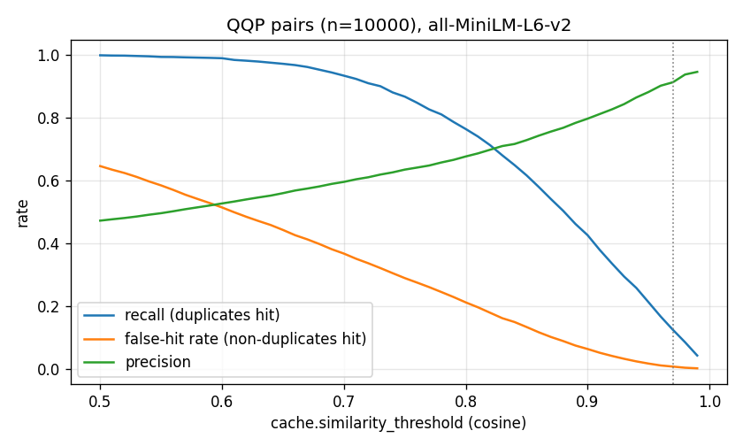
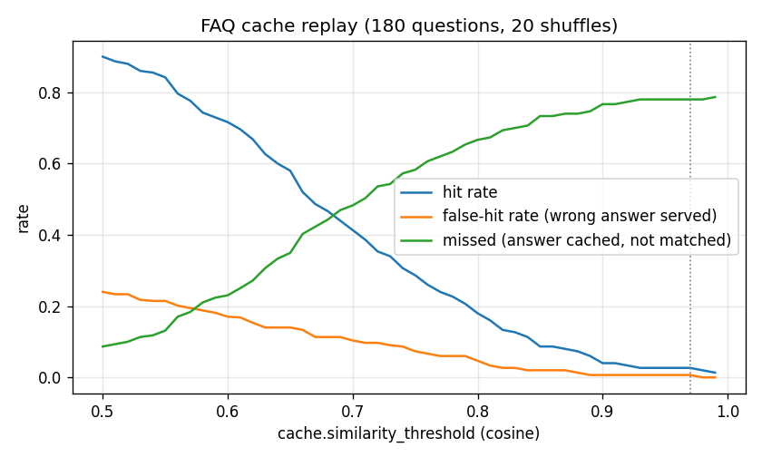

# Phase 7 — evaluation

Everything here comes from the scripts below, run on the dev laptop (i7-1165G7, WSL2, 6 vCPUs;
see `load.env.txt`). Its performance varies with the power state by up to ~2× between runs; compare
numbers *within* a table, not across phases. Embeddings are computed by the product's C++ embedder.

```bash
.venv/bin/python tools/prepare_eval.py                 # QQP sample (data/, not committed) + FAQ set
./build/release/semcache_embed_texts --in data/eval/qqp_texts.jsonl --out data/eval/qqp
./build/release/semcache_embed_texts --in data/eval/faq_texts.jsonl --out data/eval/faq
.venv/bin/python tools/analyze_threshold.py            # threshold.json, threshold_*.png
.venv/bin/python tools/run_load_eval.py                # load_*.json (real binaries + C++ loadgen)
./build/release/semcache_hnsw_eval --vectors data/eval/qqp.f32 --sizes 1000,5000,10000,18000 \
    --out bench/results/phase7/hnsw_real_qqp.json
.venv/bin/python tools/cost_model.py                   # cost_model.md
```

## 1. Hit vs false-hit: choosing `cache.similarity_threshold`

**Data.** *QQP*: 10,000 seeded pairs from the GLUE QQP validation set (`nyu-mll/glue@bcdcba79`),
3,657 labelled duplicate; its non-duplicates are often topically close (hard). *FAQ*: 30 support
intents × (canonical + 4 paraphrases) + 30 hard negatives that share most words with an intent but
mean something else (`bench/data/faq_eval.jsonl`, written for this project), replayed through
the cache's actual semantics (nearest stored question, HIT if ≥ t, otherwise stored), 20 shuffles.

 

| threshold | QQP recall | QQP false-hit | QQP precision | FAQ hit rate | FAQ false-hit | FAQ missed |
|---:|---:|---:|---:|---:|---:|---:|
| 0.80 | 0.763 | 0.211 | 0.676 | 0.180 | 0.047 | 0.667 |
| 0.85 | 0.615 | 0.133 | 0.728 | 0.087 | 0.020 | 0.733 |
| 0.90 | 0.425 | 0.063 | 0.796 | 0.040 | 0.007 | 0.767 |
| 0.95 | 0.212 | 0.017 | 0.881 | 0.027 | 0.007 | 0.780 |
| 0.96 | 0.166 | 0.011 | 0.901 | 0.027 | 0.007 | 0.780 |
| **0.97** | **0.124** | **0.007** | **0.912** | 0.027 | 0.007 | 0.780 |
| 0.98 | 0.085 | 0.003 | 0.936 | 0.020 | 0.000 | 0.780 |

QQP: AUC 0.87; median cosine 0.881 for duplicates, 0.609 for non-duplicates. "FAQ missed" = an
answer for the intent was cached but not matched.

**Decision: default `similarity_threshold = 0.97`** (was a 0.90 placeholder). Rule: the lowest
threshold at which at most 1% of QQP's look-alike non-duplicates would receive a cached answer
(0.96 → 1.06%, 0.97 → 0.69%).

**What this says about the model (all-MiniLM-L6-v2), honestly:**
- It separates *same meaning* from *similar wording* poorly. At 0.90, 6.3% of QQP non-duplicates
  would be served a wrong answer.
- Paraphrases with different words are far apart: FAQ paraphrases have a median cosine of 0.655 to
  their canonical question; only 4% reach 0.90 ("How do I talk to a human?" vs "How do I contact
  customer support?" = 0.215). Near-rewordings are close ("How can I cancel…" vs "How do I
  cancel…" = 0.996).
- Negation defeats it: "What does the warranty **not** cover?" vs "What does the warranty
  cover?" = 0.974. No embedding threshold below 0.975 avoids that wrong answer.
- So at a safe threshold the semantic layer catches **near-rewordings** only; verbatim repeats go
  through the exact fast path. Broader paraphrase matching needs a stronger model (e.g. one
  trained on paraphrase data) or a re-ranking step on the top candidates — not built.

## 2. Throughput and latency (real binaries, closed-loop C++ load generator)

Proxy (6 I/O threads, 4 embed threads), mock upstream and load generator share 6 vCPUs, so these are
lower bounds. Logging at `warn`. 32 connections unless noted.

| scenario | what is measured | throughput | p50 | p99 | upstream calls |
|---|---|---:|---:|---:|---:|
| exact HIT | 197 cached prompts, repeated verbatim | **24,518 req/s** | **1.0 ms** | 8.6 ms | 0 |
| semantic HIT | random-case variants: new prompt hash, same embedding (sim 1.0) | 307 req/s | 103 ms | 150 ms | 0 |
| MISS (upstream 0 ms) | 3,000 new prompts: embed + search + forward + store | 262 req/s | 120 ms | 195 ms | 2,953 |
| mixed, cache on | upstream 300 ms; 50% exact / 30% case variant / 20% new; 64 conns | 490 req/s | 48 ms | 488 ms | 2,868 of 14,936 |
| mixed, cache off | same workload, `cache.enabled = false` | 210 req/s | 303 ms | 327 ms | 6,348 of 6,348 |

- Exact HITs never touch the model: 1 ms median through the full HTTP stack.
- Semantic HITs and MISSes are **embedding-bound**: ~13 ms of CPU per embed on this laptop, and
  with 32 clients on 4 embed threads most of the latency is queueing for the embedder. The design's
  "≤ 10 ms added for a HIT" holds for exact HITs only on this hardware.
- Mixed workload: the cache cut upstream calls by 81% for this mix and more than doubled
  throughput at a 300 ms upstream (the mix is an assumption; real traffic decides the hit rate).

## 3. Coalescing on vs off (herd)

50 connections send the same new prompt at the same moment, 20 rounds, upstream 500 ms.

| | upstream calls | p50 | p99 |
|---|---:|---:|---:|
| coalescing on | **20** | 509 ms | 514 ms |
| coalescing off | **1,000** | 574 ms | 786 ms |

One upstream call per herd instead of 50, and a tighter tail (the mock is not the bottleneck
when hit 50× at once, so most of the tail difference is proxy-side connection and write work).

## 4. Brute force vs HNSW

End to end, one partition with ~9.8K entries (QQP questions), semantic-HIT workload, 16 connections:

| index | throughput | lookup p50 | lookup p99 | embed p50 | populate 10K |
|---|---:|---:|---:|---:|---:|
| brute force | 211 req/s | 1.41 ms | 4.9 ms | 16.4 ms | 39.9 s |
| HNSW (auto, > 5,000) | 206 req/s | 0.83 ms | 5.0 ms | 18.4 ms | 49.1 s |

The lookup itself is ~40% faster with HNSW at the median (tails are dominated by CPU contention and
coarse histogram buckets), but the request is embedding-bound, so end-to-end throughput is the same.

Recall@10 of HNSW on **real QQP embeddings** (`hnsw_real_qqp.json`), M=16, efC=200:

| n | ef=32 | **ef=64** | ef=128 | BF p50 | HNSW p50 (ef=64) |
|---:|---:|---:|---:|---:|---:|
| 1,000 | 0.9950 | **0.9994** | 1.0000 | 62 µs | 60 µs |
| 5,000 | 0.9886 | **0.9976** | 0.9994 | 238 µs | 103 µs |
| 10,000 | 0.9848 | **0.9956** | 0.9996 | 781 µs | 145 µs |
| 18,000 | 0.9808 | **0.9964** | 0.9990 | 1,927 µs | 184 µs |

Real embeddings are slightly harder than Phase 5's synthetic clusters (1.0000), still ≥ 0.995 at the
default ef=64, which stays.

## 5. Cost model

See `cost_model.md` (generated): measured recall/false-hit and embedding cost combined with
**assumed** traffic, token counts and prices. At the example prices the embedding CPU is ~$1/month
per 10M requests, so savings are set by the traffic mix — mostly exact repeats and coalesced herds.

## 6. Smaller findings

- A semantic HIT does not store an exact alias, so a repeated paraphrase pays an embedding every
  time (seen as 0.8% COALESCED during the exact-HIT run: 3 of 200 QQP prompts were semantic matches
  of each other). Storing an alias on a semantic HIT is a cheap improvement (not implemented).
- Single-machine load tests: loadgen, proxy and mock compete for the same cores.
