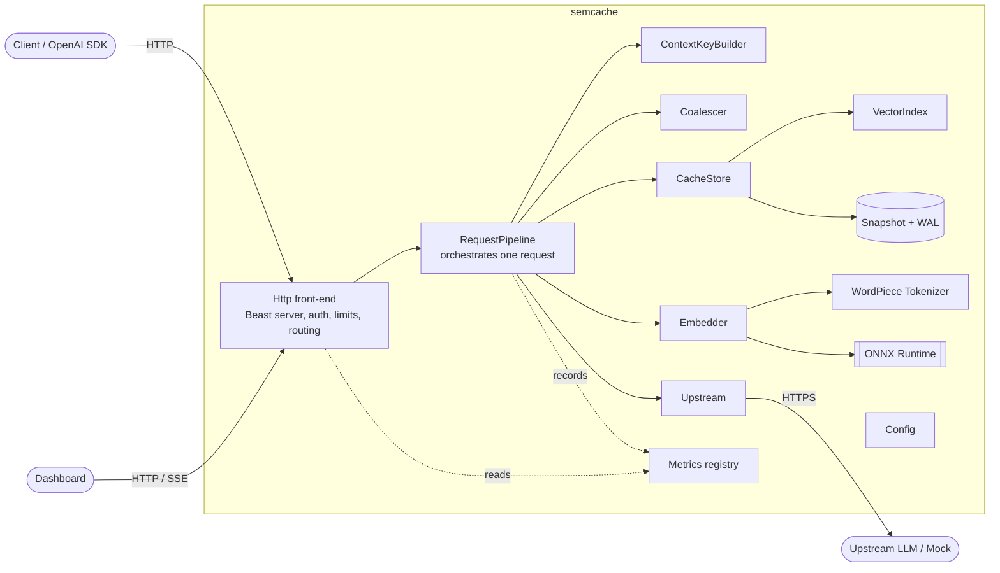
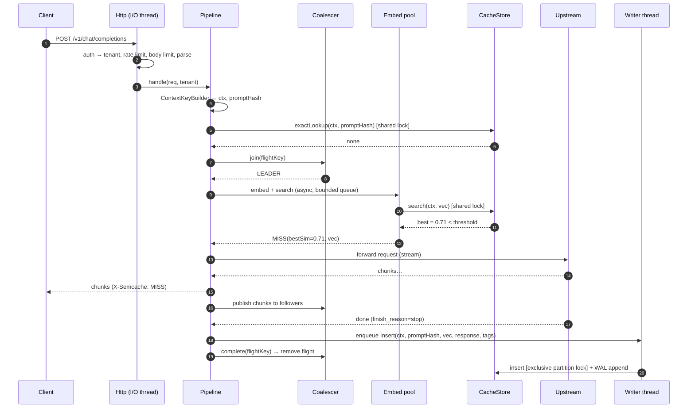
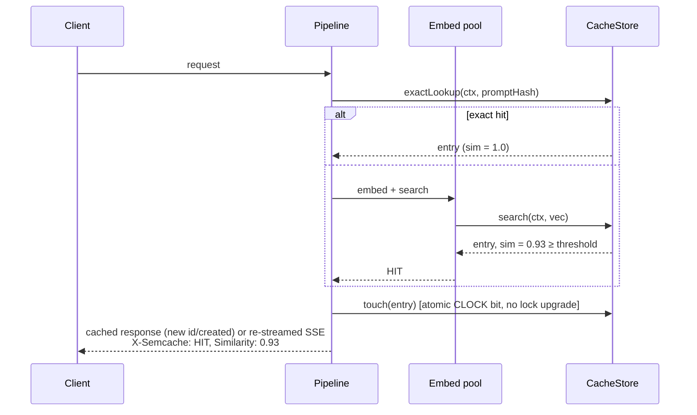
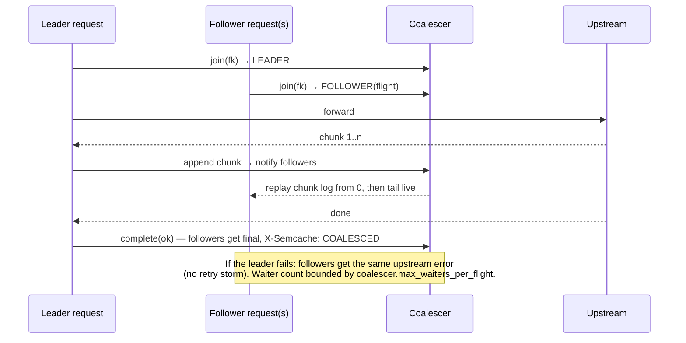

# semcache — Design

Status: **Draft for review (Phase 0)**. Numbers marked *(est.)* are back-of-envelope estimates.
Later phases replace them with measurements and record the delta in this document.

---

## 1. Problem

Applications send many LLM requests that are *semantically* repeats of earlier ones: support
questions, FAQ-style queries, retried agent steps, and duplicate requests fired concurrently.
Each costs upstream latency (hundreds of ms to seconds) and money. An exact-match cache misses
paraphrases. A naive semantic cache returns wrong answers when the context differs (another
system prompt, another tenant, another temperature) or when prompts look alike but mean
different things.

semcache is a drop-in proxy (change only `base_url`). It returns a cached answer only when:
1. the request **context** is byte-for-byte equivalent to the cached entry's context (exact
   hash match), and
2. the **latest user message** is semantically close (cosine ≥ threshold) to the cached prompt.

## 2. Functional requirements

| ID | Requirement |
|----|-------------|
| F1 | Expose OpenAI-compatible `POST /v1/chat/completions`, with both non-streaming and `stream=true` (SSE). |
| F2 | Authenticate clients with proxy-issued keys (`Authorization: Bearer sk-sc-…`) and map each key to a tenant ([ADR-001](adr/001-proxy-issued-tenant-keys.md)). |
| F3 | Compute a **context key** = SHA-256 over a canonical encoding of tenant, model, sampling params, tools, system messages and the last K prior messages ([ADR-002](adr/002-context-key-composition.md)). Only entries with an equal context key are candidates. |
| F4 | Exact-prompt fast path: if `(context key, sha256(normalized last user message))` is cached, it is a HIT with similarity 1.0 and no embedding is computed. |
| F5 | Otherwise embed the last user message in-process (all-MiniLM-L6-v2, 384-d, L2-normalized) and search the context partition for the nearest neighbour. |
| F6 | If cosine ≥ `cache.similarity_threshold`, return the cached response. Re-stream it as SSE when `stream=true`. |
| F7 | On a miss, forward to upstream, stream or return the response to the client, and store it if it is cacheable (§6.4). |
| F8 | Coalesce in-flight requests with the same flight key: one upstream call, fanned out to all waiters (streaming waiters get chunks live) ([ADR-009](adr/009-coalescing-scope.md)). |
| F9 | Response headers: `X-Semcache: HIT\|MISS\|COALESCED\|BYPASS`, `X-Semcache-Similarity` (on HIT the matched score; on MISS the best score found, if the partition was searched), `X-Semcache-Latency-Ms`. (`BYPASS` is a proposed addition: the request went straight upstream because caching was disabled for it or the cache layer failed open.) |
| F10 | Per-request opt-out: `X-Semcache-Bypass: 1` skips lookup and store. Optional `X-Semcache-Tags: a,b` attaches purge tags to the stored entry. |
| F11 | Eviction: per-entry TTL, plus approximate-LRU under a global byte budget and a per-tenant byte quota ([ADR-007](adr/007-eviction-ttl-plus-clock.md)). |
| F12 | Persistence across restart (snapshot + WAL, [ADR-008](adr/008-persistence-snapshot-plus-wal.md)) and purge by tenant / tag / context (`POST /admin/purge`). |
| F13 | Operational endpoints: `/metrics`, `/healthz`, `/readyz`, `/stats`, `/stats/stream`, `/dashboard`. |
| F14 | Demo mode: mock upstream only, a public demo tenant, per-IP limits, a reset endpoint. |

## 3. Non-functional requirements

| Area | Target | Rationale |
|------|--------|-----------|
| Added latency, HIT, p99 | ≤ **10 ms** end-to-end in proxy (embed + lookup + serialize) | The upstream it replaces is 300 ms–5 s. Embedding (§5) dominates. |
| Lookup only (index search), p99 | ≤ **2 ms** per partition | Drives the brute-force → HNSW switch point (§5.3). |
| Added latency, MISS, p99 | ≤ **12 ms** before the upstream request is sent | Embedding runs concurrently with, not before, the upstream connect ([§6.2](#62-miss-path)). |
| Throughput, all-HIT | ≥ **500 req/s** on 8 cores *(est.)* | Embedding-bound; the exact fast path raises it for repeats. |
| Memory | Configurable budget, default **1 GiB** for cache entries + index; hard cap enforced by eviction | §5.1. |
| Availability | Cache layer failures never fail a request (fail open). | Core rule. |
| Consistency | Single node: read-your-writes after the store completes. Entries may be stale up to their TTL. Purge takes effect immediately for subsequent lookups, and responses that were in flight during the purge are not stored afterwards (purge guard, ADR-008 notes). Coalesced waiters see exactly the leader's response. | A cache, not a source of truth. |
| Durability | Best-effort. With WAL `fsync` every `persistence.fsync_interval_ms`, at most that window of inserts is lost on crash. | Losing cache entries only costs money, never correctness. |
| Security | No cross-tenant reads by construction. Secrets only from env. Prompts redacted from logs by default. | §10. |

## 4. Non-goals

- Multi-node deployment (documented in §11, not implemented).
- APIs other than OpenAI chat completions (no legacy completions, embeddings, assistants, Anthropic-native API).
- Semantic matching on prior turns. Prior turns are matched **exactly** (hashed), and only the last user message is matched semantically.
- Caching multimodal inputs (image/audio parts → `BYPASS`), `n > 1`, or `logprobs`.
- Guaranteeing that a semantic HIT is the *right* answer. We measure the false-hit rate (Phase 7) and expose the threshold; we do not claim zero false positives.
- GPU inference, authN beyond static API keys, a UI framework.

## 5. Back-of-envelope sizing

### 5.1 Bytes per entry *(est.)*

| Component | Bytes | Notes |
|-----------|------:|-------|
| Embedding | 1,536 | 384 × float32, L2-normalized so cosine = dot product |
| Prompt text (last user msg) | ~500 | Median FAQ-style prompt ~80–120 tokens. Needed for the dashboard "matched prompt" and for rebuilds. |
| Response body | ~2,000–4,000 | 300–800 output tokens of JSON. Stored once in assembled form. |
| Metadata | ~200 | ids, context key (32), prompt hash (32), timestamps, usage, tags, CLOCK bit |
| Container overhead | ~150 | hash map node, vectors' headers (est.) |
| **Total** | **~5 KB** | |

**Entries per GiB ≈ 200,000** at ~5 KB. Default budget 1 GiB → `cache.max_bytes = 1 GiB`, and we
count bytes, not entries, because response size varies by 10× ([ADR-007](adr/007-eviction-ttl-plus-clock.md)).

HNSW overhead (Phase 5) with M=16: layer 0 has 2M=32 neighbour ids × 4 B = 128 B, upper layers
add ~1/M of that. That is **~150–200 B per entry** (est.), under 5%.

### 5.2 QPS and embedding budget *(est.)*

- Target node: 500 req/s sustained, with bursts up to 2,000 req/s absorbed by queues and rejected
  past `server.max_inflight`.
- all-MiniLM-L6-v2 on one modern x86 core: ~3–8 ms for a 32–128-token input (est.; Phase 2
  measures). With 4 embedding threads at ~5 ms, that is **~800 embeds/s**. Embedding is the
  throughput ceiling, which is why the exact-hash fast path (F4) and coalescing (F8) matter.
- **Measured (Phase 2, [bench/results/phase2](../bench/results/phase2/README.md)):** on the dev
  laptop (i7-1165G7, WSL2, apparently power-limited at ~35 GFLOP/s single-core) one embed takes
  **22 ms at 32 tokens and 82 ms at 128 tokens**, 3–10× the estimate. 4 threads give **87 embeds/s**,
  not ~800. Batching does not help on CPU. Delta: the estimate assumed a desktop-class core;
  re-measure on the deployment target before setting `embedder.threads` (Phase 4) or claiming the
  §3 latency targets. If they still miss, the levers are the exact fast path (F4), coalescing, and
  int8 (2–3× faster, but cosine 0.97 vs reference; [ADR-011](adr/011-pinned-upstream-onnx-model.md)).
- Upstream latency (real): 0.3–5 s. Mock: configurable, default 800 ms.
- In-flight requests at 500 req/s × 50% miss × 1.5 s ≈ **375 concurrent upstream streams**.
  Default `server.max_inflight = 1024`, `upstream.max_connections = 512`.

### 5.3 Lookup latency → index choice *(est.)*

A brute-force scan of n vectors reads n × 1,536 B. At ~10 GB/s effective single-core streaming
bandwidth (AVX2 dot products are bandwidth-bound, not compute-bound, at this size):

| n per partition | Bytes scanned | Scan time *(est.)* |
|----------------:|--------------:|-------------------:|
| 1,000 | 1.5 MB | ~0.15 ms (L2/L3 resident, faster) |
| 10,000 | 15 MB | ~1.5 ms |
| 20,000 | 30 MB | ~3 ms |
| 200,000 | 300 MB | ~30 ms |

With a 2 ms lookup budget, brute force covers partitions up to **~10–13K entries**. Partitions
are per context key, so most are small. A single high-traffic app with one system prompt, though,
puts all its entries in **one** partition, which is the case HNSW exists for. Decision: brute
force first, HNSW behind the same interface, with the switch point
`index.hnsw_min_partition_size` set from Phase 5 measurements
([ADR-006](adr/006-brute-force-first-then-hnsw.md)). Future lever: fp16/int8 vectors halve or
quarter the bandwidth.

**Measured (Phase 3, [bench/results/phase3](../bench/results/phase3/README.md)):** AVX2 top-8 scan
takes 69 µs at 1K, **1.3 ms at 10K**, 2.8 ms at 20K and 16 ms at 100K vectors (~10–11 GiB/s once
out of cache), in line with the estimates above. The 2 ms budget holds to **~15K vectors per
partition**. The scalar fallback is ~15× slower. End-to-end on the dev box: an exact HIT adds
~0.6 ms in the proxy; a semantic HIT ~10 ms, dominated by embedding (§5.2).

**Measured (Phase 5, [bench/results/phase5](../bench/results/phase5/README.md)):** HNSW (M=16,
efC=200, ef=64) reaches recall@10 = 1.0000 on clustered synthetic data at 1K–50K vectors, with p50
224 µs at 10K and 889 µs at 50K (brute force: 1,451 µs and 9,017 µs). `index.hnsw_min_partition_size`
= **5,000**: the last measured size where brute force's p99 stays under the 2 ms budget. The
upgrade costs a one-off ~3 s graph build on the writer thread.

**Measured (Phase 6, [bench/results/phase6](../bench/results/phase6/README.md)):** ~3.7 KB on
disk per entry (2 KB response). 20K entries in 200 brute-force partitions recover in 0.26 s; one
20K-entry HNSW partition takes ~17 s, because graphs are rebuilt from vectors (~0.85 ms per HNSW
insert). The same cost caps the writer at ~1K inserts/s into a large HNSW partition (8K/s into
brute-force partitions). Levers if the target hardware confirms it: background recovery while
serving passthrough, persisting graph links, or a lower `hnsw_ef_construction`.

### 5.4 Request limits (derived)

- `server.max_body_bytes = 1 MiB`. A 128K-token context is ~500 KB of text, so this is generous;
  larger bodies get 413.
- `embedder.max_tokens = 256` (the sentence-transformers training max_seq_length for MiniLM).
  When the last user message exceeds it, the request uses the **exact fast path only**. We never
  semantically match a truncated prompt, because two long prompts that share their first 256
  tokens would collide.
- `cache.max_response_bytes = 64 KiB`. Larger responses are served but not stored, because they
  would distort the byte budget.

## 6. Architecture

### 6.1 Components



Interfaces (C++ abstract classes or concepts, decided in Phase 1, all `noexcept`-friendly and
returning `std::expected`-style results, no exceptions across module boundaries):

| Module | Responsibility | Depends on |
|--------|----------------|------------|
| `Config` | Load TOML, apply `SEMCACHE_*` env overrides, validate, expose an immutable struct. | — |
| `Metrics` | Counters, gauges, fixed-bucket histograms (atomics). Prometheus text + JSON. | — |
| `ContextKeyBuilder` | Pure function: parsed request + tenant → `ContextKey` (32 B) + `PromptHash` + embed text, or `NotCacheable{reason}`. | — |
| `Embedder` | `embed(span<string>) → expected<vector<Embedding>>`. Owns tokenizer + ORT session. | — |
| `VectorIndex` | `add(id, vec)`, `remove(id)`, `search(vec, k) → [(id, score)]`. Brute force / HNSW. Not thread-safe by itself; CacheStore guards it. | — |
| `CacheStore` | Partitions by ContextKey, entries, TTL, eviction, byte accounting, tags, purge, single writer. | VectorIndex, Persistence |
| `Persistence` | Snapshot + WAL encode/decode, CRC, recovery. | — |
| `Upstream` | Async HTTPS client with connection pool. Streams chunks via callback. Timeouts. | — |
| `Coalescer` | In-flight map FlightKey → Flight (shared chunk log + waiters). | — |
| `RequestPipeline` | The only place that composes the above for one request. | all of the above (by interface) |
| `Http` | Beast server, routing, auth, rate limits, body limits, headers, SSE writer. | RequestPipeline, Metrics |

Dependencies point inward: leaf modules know nothing about HTTP or each other. `RequestPipeline`
receives interfaces by reference at construction (composition root in `main.cpp`), so tests can
inject a fake Embedder / fake Upstream.

### 6.2 Data flow

#### MISS path



The pipeline runs embed+search **before** forwarding upstream, because a semantic HIT must
short-circuit. To keep the MISS overhead to one embed (~5 ms est.), the upstream connection is
checked out of the pool in parallel with the embed.

#### HIT path



#### COALESCED path



### 6.3 Request classification (ContextKeyBuilder)

A request is **cacheable** only if all hold: the last message has `role=user` with text-only
content; `n` is absent or 1; no `logprobs`; `temperature ≤ cache.max_temperature` (default 2.0,
i.e. cache everything, with temperature in the key); no `X-Semcache-Bypass`; the tenant has
caching enabled. Anything else → `BYPASS` (forwarded, not stored, not coalesced).

Canonical encoding hashed into the context key (length-prefixed fields, never string
concatenation, so `"ab"+"c"` ≠ `"a"+"bc"`):

```
v1 | tenant_id | model | temperature | top_p | max_tokens | stop[] | presence_penalty |
frequency_penalty | seed | response_format(canonical JSON) | tools(canonical JSON) |
tool_choice | system/developer messages (all, in order) |
last K non-system messages before the final user message (role, content, tool_calls, tool_call_id)
```

- Missing params are encoded as an explicit "absent" marker, **not** as the API default. Upstream
  defaults can change.
- Floats are encoded via shortest round-trip representation (`std::to_chars`).
- Canonical JSON = sorted keys, no whitespace, so key order in `tools` does not split partitions.
- `stream` is **not** part of the key. A streamed and a non-streamed request share entries.
- `cache.history_k` (default 2, `-1` = all) — see [ADR-002](adr/002-context-key-composition.md)
  for the false-hit risk.

Embed text = last user message, Unicode-NFC, whitespace-trimmed. Prompt hash = SHA-256 of that.

### 6.4 What gets stored

Store only if: upstream status 200; `finish_reason` ∈ `cache.store_finish_reasons` (default
`["stop", "tool_calls"]`, so length-truncated answers are not cached); body ≤
`cache.max_response_bytes`; the stream completed cleanly. Streaming responses are assembled into
the same JSON shape as non-streaming ones before storage. On HIT the stored response is returned
with a fresh `id` and `created`, and the original `usage` is preserved (it feeds "tokens saved").

### 6.5 Re-streaming a hit

For `stream=true` hits, the stored message is emitted as `chat.completion.chunk` events split on
word boundaries (`cache.restream_chunk_chars`, default 16), with no artificial delay by default
(`cache.restream_delay_ms = 0`), followed by `data: [DONE]`. Headers are sent before the body, so
for streaming responses `X-Semcache-Latency-Ms` = time to headers. Total time is appended as a
final SSE comment `: semcache-total-ms=…`.

## 7. Concurrency model

### 7.1 Threads

| Thread(s) | Count (config) | Does | Never does |
|-----------|----------------|------|-----------|
| I/O threads | `server.io_threads` (default = hw cores) | Run one `asio::io_context`: accept, parse, auth, rate limit, upstream async I/O, SSE writes, coalescer fan-out. Each connection runs on its own strand. | Block. No ORT calls, no disk I/O, no exclusive index locks. |
| Embed pool | `embedder.threads` (default 4) | Pop job from bounded MPMC queue (`embedder.queue_capacity`), tokenize, ORT `Run` (`intra_op_num_threads = 1`), then index **search** under a shared lock, then post the result back to the request's strand. | Hold a lock across `Run`. |
| Writer | 1 | Sole mutator of CacheStore: inserts, deletes, TTL expiry, evictions, purges. Appends each mutation to the WAL in the same order. | Network I/O. |
| Maintenance | 1 | Timers: TTL sweep (enqueues deletes to writer), snapshot (shared locks, partition by partition), WAL fsync, metrics gauges refresh. | Mutate the store directly. |
| Snapshot (as built, Phase 6) | 1 | Replaces the maintenance thread's snapshot duty: serializes an immutable point-in-time copy of the entry pointers handed over by the writer, without any lock. WAL fsync runs on the writer between mutations; the TTL sweep is a writer job queued by a timer. | Touch the store. |

Single writer gives a total order of mutations (which makes the WAL trivially consistent) and
keeps index writes off the hot read path. The cost is that inserts become visible
asynchronously, typically < 1 ms later. A request arriving in that window misses and goes upstream
once more. This is acceptable for a cache and is covered by coalescing (§7.3).

### 7.2 Shared state and protection

| State | Protection | Readers | Writers |
|-------|------------|---------|---------|
| `Config` | Immutable after startup (`shared_ptr<const Config>`) | all | none |
| Metrics counters/histograms | `std::atomic` (relaxed), fixed buckets | all | all |
| Partition map `ContextKey → Partition` | `std::shared_mutex` **L2** | embed pool, I/O (exact lookup) | writer |
| Partition (entries, exact map, VectorIndex) | `std::shared_mutex` per partition **L3** | embed pool, I/O, maintenance (snapshot) | writer |
| Entry CLOCK/referenced bit, hit count | `std::atomic` inside the entry | readers set it | writer clears it during eviction |
| Coalescer flight map | `std::mutex` **L1** | I/O threads | I/O threads |
| Flight (chunk log, state, waiter list) | `std::mutex` per flight **L1b** | I/O threads | leader's strand |
| Embed job queue / writer queue | bounded MPMC queues (mutex + condvar in v1) | consumers | producers |
| Rate limiter buckets | sharded `std::mutex` (16 shards by key hash) | I/O | I/O |
| Recent-requests ring (for /stats) | `std::mutex`, fixed size 50 | I/O | I/O |

Entries are handed to readers as `shared_ptr<const Entry>`, so eviction can drop an entry from
the partition while a reader is still serializing it. Readers copy out the pointer under the
shared lock and release the lock before any I/O.

### 7.3 Lock ordering

1. **L1 (flight map) → L1b (one flight).** L1 is held only to find, insert or erase a flight
   and is released before touching any other lock.
2. **L2 (partition map) → L3 (one partition).** L2 is released as soon as the partition
   `shared_ptr` is obtained. At most one L3 is held at a time. Snapshotting walks partitions one
   by one.
3. L1/L1b and L2/L3 are **never** held simultaneously.
4. No lock is held across: socket I/O, ORT `Run`, disk I/O (except the writer thread holding L3
   exclusively while it appends to an in-memory WAL buffer; fsync happens without locks), or
   posting to another executor.

TSan runs on the full integration suite in CI (Phase 4 gate).

**As implemented (Phase 4):** `CacheWriter` is the single writer thread. Inserts (from I/O
threads after a MISS) and TTL sweeps (from the sweeper timer) are submitted to its bounded queue
(`cache.writer_queue_capacity`; full → insert dropped, `semcache_store_dropped_total`). Inside
`CacheStore`, mutations still take a writer mutex **W** before L2/L3 (order W → L2 → L3). It is
uncontended in production, where only the writer thread mutates, and keeps direct calls from tests
safe. Readers never take W. The coalescer adds **L1** (flight map) and **L1b** (one flight); a
follower's wakeup is a capacity-1 `concurrent_channel`, signalled after L1b is released, so no
wakeup is lost and no lock is held while notifying.

### 7.4 Backpressure

| Point | Bound | When full |
|-------|-------|-----------|
| Accepted connections | `server.max_connections` | Stop accepting (kernel backlog absorbs) |
| In-flight requests | `server.max_inflight` (atomic counter) | 503 + `Retry-After` |
| Embed queue | `embedder.queue_capacity` | **Fail open**: skip lookup, forward upstream, `BYPASS`, no store |
| Writer queue | `cache.writer_queue_capacity` | Drop insert, count `semcache_store_dropped_total` |
| Waiters per flight | `coalescer.max_waiters_per_flight` | New request becomes independent (forwarded upstream) |
| Per-key / per-IP rate | token bucket `limits.rps`, `limits.burst` | 429 + `Retry-After` |
| Request body | `server.max_body_bytes` | 413 |

## 8. Failure modes

Rule: **if upstream could have served the request, the client gets upstream's answer.** The cache
only ever removes work.

| Failure | Detection | Behaviour | Client sees | Metric |
|---------|-----------|-----------|-------------|--------|
| Upstream connect/first-byte timeout | `upstream.connect_timeout_ms`, `upstream.first_byte_timeout_ms` | Abort, no store, followers get the same error | 504 (OpenAI-style error JSON) | `upstream_errors_total{kind="timeout"}` |
| Upstream total / idle-stream timeout | `upstream.total_timeout_ms`, `upstream.idle_timeout_ms` | Abort mid-stream, no store | Non-stream: 504. Stream: SSE `error` event then close | same |
| Upstream 4xx | status | Pass through verbatim, never stored | Upstream's status/body | `upstream_responses_total{code}` |
| Upstream 5xx | status | Pass through, never stored. No proxy retries in v1 (they would double cost). | Upstream's status/body | same |
| Upstream dies mid-stream | EOF/reset before `[DONE]` | Nothing stored. Followers get an error event. | Truncated stream + SSE error event | `upstream_errors_total{kind="reset"}` |
| Client disconnects mid-stream | write error | Leader **continues** the upstream read if followers exist or the response is cacheable (bounded by total timeout), so the work is not wasted. Otherwise cancel. | — | `client_disconnects_total` |
| Embedder failure (ORT error, bad input) | `expected` error | Fail open: forward, no store | `BYPASS` | `embed_errors_total` |
| Embedder not loaded (model missing) | startup | Start anyway in exact-only mode; `/readyz` reports degraded | exact HITs only | `embedder_ready=0` |
| Embed queue full / overload | queue bound | Fail open | `BYPASS` | `embed_queue_rejected_total` |
| Index/store internal error (exception, invariant violation) | try/catch at module boundary + assertions in debug | Fail open for that request; partition marked bad and dropped by the writer | `BYPASS` | `cache_internal_errors_total` |
| Snapshot corrupt at startup | magic/version/CRC mismatch | Rename to `*.corrupt-<ts>`, start empty, keep serving | — | `persistence_recovery_total{result="corrupt_snapshot"}` |
| WAL torn tail / bad record | CRC per record | Truncate at the first bad record, keep the prefix | — | `persistence_recovery_total{result="wal_truncated"}` |
| Disk full / write error | `write`/`fsync` errno | Disable persistence (memory-only), log once per minute, retry every `persistence.retry_interval_ms` | — | `persistence_enabled=0` |
| Memory budget exceeded | byte accounting | Writer evicts (CLOCK) before insert. A single entry > budget is not stored. | — | `evictions_total{reason}` |
| Proxy overload | `max_inflight` | 503 + Retry-After (the one case where we fail closed, because accepting more would hurt everyone) | 503 | `rejected_total{reason="overload"}` |
| Bad request JSON | parser | 400 OpenAI-style error, not forwarded | 400 | `bad_requests_total` |
| Unknown / missing key | auth | 401, not forwarded | 401 | `auth_failures_total` |

## 9. Observability

- **Logs:** spdlog JSON lines, one per request: `ts, req_id, tenant, route, status, cache
  (HIT/MISS/…), similarity, latency_ms, upstream_ms, bytes_in/out, error`. Prompt/response text
  only when `logging.log_prompts = true` (default false). API keys are never logged; only tenant
  ids appear.
- **`/metrics` (Prometheus text):** `semcache_requests_total{result}`, `semcache_lookup_seconds`
  (histogram), `semcache_embed_seconds`, `semcache_upstream_seconds`,
  `semcache_request_seconds{result}`, `semcache_index_entries`, `semcache_index_bytes`,
  `semcache_partitions`, `semcache_evictions_total{reason}`, `semcache_inflight`,
  `semcache_coalesced_total`, `semcache_tokens_saved_total`, plus the error counters in §8.
- **`/healthz`:** process liveness (always 200 if the loop runs). **`/readyz`:** JSON
  `{"status": "ready"|"degraded", "degraded": [...]}`. Degraded (e.g. embedder not loaded) is still
  **200**: the node serves every request by passthrough, so taking it out of rotation would turn a
  cache problem into an outage (fail open). Alert on `semcache_embedder_ready == 0` instead.
- **`/stats`:** JSON snapshot for the dashboard: totals, hit rate, latency summaries, index size,
  in-flight, a histogram, and a recent-requests ring **without prompt text**. **`/stats/stream`:**
  the same as SSE every `stats.stream_interval_ms`.

## 10. Security

- **Keys:** the upstream key comes from `SEMCACHE_UPSTREAM_API_KEY`. Each tenant's client key is
  read from the env var named in config (`tenants[].key_env`). Only SHA-256(key) is kept in
  memory. Lookup is by hash, so there is no timing-sensitive string compare.
- **Isolation:** tenant id is the first field of the context key, so partitions are disjoint per
  tenant. There is no API that lists or searches across partitions except admin purge (admin key
  required).
- **Admin:** `/admin/*` requires `SEMCACHE_ADMIN_KEY`. When unset, the endpoints are disabled.
- **Demo mode:** refuses to start unless upstream is the mock (no upstream key set, upstream host
  is in `demo.allowed_upstreams`). The demo tenant key is public by design and only exists in demo
  mode. The dashboard shows prompt text only from its own browser session (held client-side).
  `/stats` never returns prompts.
- **Logs:** redaction by default (§9). Request bodies are never logged on error paths unless
  `log_prompts` is on.

## 11. Scaling past one node (not implemented)

- **Shard by context key.** Partitions are already independent: no query spans two context keys.
  A consistent-hash ring on `ContextKey` (or on tenant, for locality) routes each request to the
  owning node. Any stateless L7 router can compute the key; alternatively each node forwards to the
  owner, at one extra hop.
- **Per-node index, not shared.** A shared vector DB adds a network round-trip (~1 ms+) to every
  lookup and becomes a single point of failure. Per-shard in-memory indexes keep the 2 ms budget.
  The cost is rebalancing: moving a shard means shipping its snapshot, and the new owner is cold
  until it loads.
- **Hot partitions.** One huge tenant/system-prompt partition can outgrow a node. The fix is
  read replicas of that shard (same snapshot + WAL stream, eventually consistent), or splitting by
  a secondary key at the cost of lower recall.
- **Coalescing across nodes** works automatically under key-sharding, since identical requests
  land on the same node. Near-duplicate coalescing stays node-local.
- **Consistency.** Replicas lag by WAL shipping delay. Purges are broadcast and idempotent. A
  stale hit after a purge is bounded by replication lag, which we document instead of hiding.
- **Embedding** stays on each node (stateless, CPU-bound, scales horizontally).

## 12. Configuration (schema sketch)

TOML file (`--config path`). Every key can be overridden by `SEMCACHE_<SECTION>__<KEY>` (double
underscore separates the section). Values are validated at startup, and invalid config means exit
non-zero with a message. Every value below has a default in one place (`config_defaults.hpp`).

```toml
mode = "live"            # "live" | "demo"

[server]
listen = "0.0.0.0:8080"
io_threads = 0           # 0 = hardware_concurrency
max_connections = 4096
max_inflight = 1024
max_body_bytes = 1048576
header_timeout_ms = 5000
body_timeout_ms = 10000

[upstream]
base_url = "https://api.openai.com"
max_connections = 512
connect_timeout_ms = 3000
first_byte_timeout_ms = 30000
idle_timeout_ms = 30000
total_timeout_ms = 120000

[embedder]
model_path = "models/all-MiniLM-L6-v2.onnx"
vocab_path = "models/vocab.txt"
threads = 4
queue_capacity = 1024
max_tokens = 256

[cache]
enabled = true
similarity_threshold = 0.90   # placeholder; Phase 7 sets the default from the curve
history_k = 2
max_temperature = 2.0
default_ttl_s = 86400
max_bytes = 1073741824
max_response_bytes = 65536
store_finish_reasons = ["stop", "tool_calls"]
writer_queue_capacity = 4096
restream_chunk_chars = 16
restream_delay_ms = 0
sweep_interval_ms = 60000

[index]
kind = "auto"                 # "brute" | "hnsw" | "auto"
hnsw_min_partition_size = 5000    # measured in Phase 5 (bench/results/phase5)
hnsw_m = 16
hnsw_ef_construction = 200
hnsw_ef_search = 64

[coalescer]
enabled = true
max_waiters_per_flight = 1000
near_duplicate = false

[persistence]
enabled = true
dir = "data"
snapshot_interval_s = 300
fsync_interval_ms = 1000
retry_interval_ms = 30000
max_wal_bytes = 268435456

[limits]
rps = 50
burst = 100

[logging]
level = "info"
log_prompts = false

[pricing]
usd_per_1k_input_tokens = 0.0
usd_per_1k_output_tokens = 0.0

[demo]
allowed_upstreams = ["mock:9090", "127.0.0.1:9090"]
per_ip_rps = 2
per_ip_burst = 10
max_prompt_chars = 500
max_bytes = 67108864

[[tenants]]
id = "acme"
key_env = "SEMCACHE_KEY_ACME"
max_bytes = 268435456
ttl_s = 86400
```

## 13. Testing strategy

| Layer | What | Where |
|-------|------|-------|
| Unit | context-key canonicalization (field-order invariance, absent ≠ default), tokenizer golden parity, SIMD dot vs scalar, index add/remove/search, TTL/CLOCK eviction, WAL encode/decode/CRC, config/env overrides, rate limiter | `tests/unit` |
| Integration | real proxy + mock upstream in-process: passthrough, SSE, HIT/MISS/COALESCED headers, tenant isolation, bypass, 4xx/5xx passthrough, purge | `tests/integration` |
| Concurrency | thundering herd (N identical → 1 upstream call), concurrent read/insert/evict under TSan | `tests/integration` (TSan job) |
| Fault injection | mock upstream modes: delay, 5xx, reset mid-stream, hang; corrupt/truncated snapshot and WAL; read-only data dir (disk-full proxy); embedder forced failure | `tests/fault` |
| Load | closed-loop load generator (C++), latency histograms, throughput | `bench/` |
| Quality | QQP + synthetic FAQ threshold sweep | `bench/eval` (Python tooling + C++ eval binary) |

## 14. Known weaknesses and assumptions (up front)

- **Semantic false hits are inherent.** "Refund policy for plan A" vs "plan B" may score above
  threshold. Mitigations: exact context key, threshold tuning from a measured curve, per-tenant
  threshold override, bypass header. Phase 7 and the dashboard trap scenario show this openly.
- **`history_k` < all trades correctness for hit rate** ([ADR-002](adr/002-context-key-composition.md)).
- **Model-version drift:** an alias like `gpt-4o` can change upstream behind the same name. The
  cache will serve the old model's answers until the TTL expires. Operators should pin dated
  model ids or purge.
- **Temperature > 0:** a cached answer is one sample. Clients that rely on sampling diversity
  should send the bypass header or set `max_temperature`.
- **Tool-call responses** are cached only within an identical tools definition. Side-effecting
  agents should bypass.
- **Asynchronous insert window** (§7.1) can cause an extra upstream call shortly after a miss.
- Sizing numbers above are estimates until Phases 2, 3, 5 and 7 measure them.

## 15. ADR index

| # | Decision |
|---|----------|
| [001](adr/001-proxy-issued-tenant-keys.md) | Proxy-issued tenant keys; upstream key held server-side |
| [002](adr/002-context-key-composition.md) | Context key composition; last K=2 prior messages |
| [003](adr/003-dependencies-vcpkg-prebuilt-ort.md) | vcpkg manifest + prebuilt pinned ONNX Runtime |
| [004](adr/004-own-wordpiece-tokenizer.md) | Own WordPiece tokenizer with golden parity tests |
| [005](adr/005-threading-model.md) | Asio I/O pool + embed pool + single writer |
| [006](adr/006-brute-force-first-then-hnsw.md) | Brute-force SIMD first, HNSW behind the same interface |
| [007](adr/007-eviction-ttl-plus-clock.md) | TTL + CLOCK (approximate LRU) under a byte budget |
| [008](adr/008-persistence-snapshot-plus-wal.md) | Snapshot + WAL persistence |
| [009](adr/009-coalescing-scope.md) | Coalesce on exact flight key; near-duplicate optional |
| [010](adr/010-embedded-dashboard.md) | Dashboard as static files embedded in the binary |
| [011](adr/011-pinned-upstream-onnx-model.md) | Published ONNX export pinned by revision + SHA-256 |
